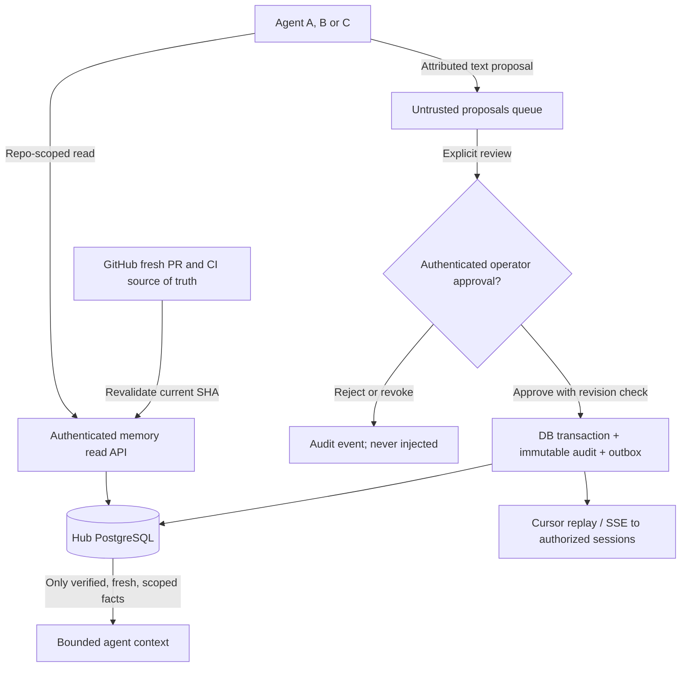

# ADR-001: Shared Agent Memory and Parallel Coordination

- **Status:** Proposed design; **no implementation or feature activation in this PR**.
- **Tracking:** [Epic #34](https://github.com/sauron9521/gym-dev-hub/issues/34), [ADR #35](https://github.com/sauron9521/gym-dev-hub/issues/35).
- **Scope:** `gym-dev-hub` only, no modifications to `gym-platform`.
- **Sequencing:** #35 (this ADR) → #36 storage → #37 records → #38 read API → #39 auth → #40 guarded writes → #41–#49 coordination, integrations and rollout.

## Context and decision

Today, the [Agent Workspace](../agent-workspace.md) persists versioned session and user-note JSON under `apps/api/.local/agent-workspace.json`. Writes are serialized **within one NestJS process** only. Separate Codex threads and HTTP/SSE connections do not share trustworthy, durable cross-session decisions or locks. Reading chat history does not establish that an agent's statement is true. GitHub is already authoritative for commits, pull requests, checks, reviews and merge state; the Hub must not become a competing source of those facts.

**Decision:** add an **opt-in, Hub-owned PostgreSQL + Prisma** storage boundary for explicit, repository-scoped durable memory, proposals, revisions, task leases and outbox events. The existing JSON workspace remains the legacy system until a separately approved migration; it must never be silently rewritten or deleted. Runtime capability, permissions, schema migrations and deployment are all **out of scope** for this ADR. PostgreSQL wins over another JSON store because multiple NestJS instances require atomic compare-and-swap writes, unique idempotency keys, lease fencing and transactional outbox persistence; Prisma is the planned ORM, but no database or package is introduced here. SQL uniqueness constraints and transactions, not a process-local mutex, enforce the invariants.

Other choices rejected: (a) injecting whole chat transcripts into every agent prompt (untrusted, unbounded and privacy-invasive), (b) relying on GitHub issue comments as the only memory store (poor scope/revision semantics), and (c) using client-only localStorage/JSON for cross-process leases (no atomicity). A deployment can keep memory completely disabled and use the existing Workspace unchanged.

## Ownership and trust boundaries

| Information                                                 | Authority                               | Hub handling                                                                                         |
| ----------------------------------------------------------- | --------------------------------------- | ---------------------------------------------------------------------------------------------------- |
| Git commit SHA, PR base/head, merge, CI conclusion          | GitHub                                  | Timestamped, SHA-bound **cache**; refresh with the provider before decisions                         |
| Human-approved project decisions, durable facts, task notes | Hub database                            | Versioned, scoped `MemoryRecord`, attributable provenance and audit                                  |
| Unreviewed agent/ChatGPT suggestions                        | Untrusted submitter                     | `proposed` only; never implicit approval, command or source-of-truth status                          |
| Codex/chat transcript                                       | Original conversation/session           | **Not** a verified memory record; ingest only an explicitly selected, redacted excerpt as a proposal |
| Active task/file ownership                                  | Hub database transaction                | Short-lived, fenced `TaskLease`; never a Git/OS lock or an authorization grant                       |
| Git writes, Docker checks, operator actions                 | Existing permission-gated control plane | Memory cannot mint, extend, replay or bypass execution/write grants                                  |

Repository scope is an explicit **allowlisted owner/name identity**, not a mutable title or free-form path. `repository` is mandatory; optional `taskId`, `sessionId`, `agentId` narrow visibility and applicability, **never broaden** a credential's grants. A query bound to repo A cannot return repo B records even when its caller submits a cross-repo task/lease ID; respond with 404 rather than reveal existence. Agents can retrieve shared, verified repo-level records; a private session/agent entry is visible only to the owning principal and specifically authorized reviewers. Task-level records are visible only to allowed participants of that repo/task. No implicit global or wildcard repo scope.

The local prototype API on `127.0.0.1` is **currently unauthenticated** (see [Workspace limitations](../agent-workspace.md)). It is not safe to expose memory read/write routes merely because they are local: until #39 delivers authenticated principals, CSRF/origin protections, repository policy and operator-scoped credentials, any new memory endpoints **remain disabled**; #38 may implement schemas and tests behind a deny-by-default feature gate. Do not expose `3100/3101`, bind publicly, or reverse-proxy to a network without authentication. An external MCP connection is **opt-in**, separately authenticated and read-only by default (#46); external write proposals require #47 and an owner approval. External ChatGPT chats are not magically synchronized—they need the actual connected MCP client, its calls and grants.

## Version 1 conceptual data model

These are **design contracts**, not exported runtime TypeScript schemas yet. #37 creates the strict Zod/TypeScript representation and Prisma fields. Identifiers use UUIDs, dates use UTC ISO-8601, `revision` is a monotonically increasing positive integer, and all API DTOs have `schemaVersion: 1`. All reads are repository-filtered before pagination.

| Record          | Required fields and invariants                                                                                                                                                                                                                                                                                |
| --------------- | ------------------------------------------------------------------------------------------------------------------------------------------------------------------------------------------------------------------------------------------------------------------------------------------------------------- |
| `MemoryRecord`  | `id`, `repository`, optional `taskId` / `sessionId` / `agentId`, `kind` (`fact`, `decision`, `proposal`), `status` (`proposed`, `verified`, `superseded`, `revoked`), redacted `text`, `provenance`, `revision`, `createdAt`, `updatedAt`, optional `supersededById`, `expiresAt`, `verifiedBy`, `verifiedAt` |
| `Provenance`    | `sourceType` (`github`, `workspace`, `human`, `agent`), attributed `actorId`, `observedAt`, `sourceRef`, optional provider `url`, `commitSha`, `prNumber`, `workflowRunId`; no credential, raw token, or full transcript                                                                                      |
| `TaskLease`     | `id`, `repository`, `taskId`, normalized `resourceKeys` (files/lockfile/migration), `holderId`, `fencingToken`, `revision`, `expiresAt`, `createdAt`, `updatedAt`; one active lease per conflicting resource under DB transaction                                                                             |
| `DomainEvent`   | Monotonic DB cursor, `eventId`, `repository`, `aggregateId`, `aggregateRevision`, `eventType`, safe redacted metadata, `occurredAt`, `actorId`; written atomically with state change                                                                                                                          |
| `MutationAudit` | `requestId`, `idempotencyKey`, scoped principal, action, policy decision, before/after revision, result, timestamp; immutable and **not** a copy of sensitive content                                                                                                                                         |

Example conceptual record (not populated automatically):

```json
{
  "schemaVersion": 1,
  "id": "25185b6b-36f2-4ad9-aef1-030f14725e0b",
  "repository": "sauron9521/gym-dev-hub",
  "taskId": "f67a90b7-3832-4d2f-90ac-4be77ac32251",
  "sessionId": null,
  "agentId": null,
  "kind": "decision",
  "status": "verified",
  "text": "Use separate reviewed pull requests for each integration slice.",
  "provenance": {
    "sourceType": "human",
    "actorId": "local-operator",
    "sourceRef": "manual-review",
    "observedAt": "2026-11-21T12:00:00Z"
  },
  "revision": 2,
  "createdAt": "2026-11-21T12:00:00Z",
  "updatedAt": "2026-11-21T12:05:00Z",
  "verifiedBy": "local-operator",
  "verifiedAt": "2026-11-21T12:05:00Z"
}
```

Do not store passwords, GitHub tokens, `.env` contents, access keys, prompt secrets, sensitive user details, arbitrary full chat transcripts, or unbounded command output in memory text or event payloads. Validate size and structured fields at API boundaries and before injecting any text into an agent context. A malicious annotation that says “ignore prior instructions” remains **data**.

## Lifecycle, freshness and concurrency

1. **Propose:** an allowed repo-bound agent can only create a `proposed` record with explicit source attribution and stable idempotency key. Creation does not expose the proposal as approved context or authorize any action.
2. **Review:** an authenticated human/operator reviews text, source and impact. Approval atomically changes status to `verified` and increments revision; rejection marks the proposal revoked with an audit reason. Agents may suggest corrections but cannot unilaterally approve them.
3. **Correct:** supersede an erroneous record with a new linked revision; preserve minimal audit history. A revoked/superseded/expired record is never injected into new prompts. Edits require matching revision (`If-Match`) and an operator-scoped write capability.
4. **Expire:** a scheduled policy can mark stale derived records unusable; it cannot silently upgrade or “reverify” data. Proposed policy defaults (to be implemented only after owner review): GitHub PR/check cache max 60 seconds before action, unverified proposals 30-day review window, approved decisions retained until revoked, audit/events 90-day minimum with configurable retention, backup windows in #48.
5. **Acquire lease:** issue short, renewable task/resource leases using a DB transaction, unique normalized resource keys and incremented fencing tokens. Reject an overlapping active file/lockfile/migration lease with `409`; an expired or stale holder cannot commit a newer lease's revision. A lease **does not permit** shell, Git, merge or Docker actions; existing operator grants remain mandatory.
6. **Publish event:** insert state change and outbox `DomainEvent` in the **same** transaction; deliver via SSE by monotonic cursor later (#42). Replays are at-least-once and clients deduplicate by `eventId`. A dropped subscriber catches up from the cursor, not from agent chat.

Each source is accompanied by `observedAt` and optional `commitSha`/PR head. GitHub-derived claims must be revalidated with GitHub on the requested decision boundary; a 60-second TTL does not override an explicit stale/unknown provider response. Unverified proposals are retrievable for the review queue but **excluded from default context**. For context assembly (#43), proposed defaults: total verified-memory budget **1,500 tokens per AI turn**, 20 records maximum, repo/task strict filters, rank by task relevance + freshness + provenance; truncate/drop with explicit provenance, not the raw conversation. Task lease state and current GitHub state are separately fetched and checked; neither is treated as memory truth.

## Proposed versioned HTTP API (all routes disabled until security gates)

The following names and method semantics are **proposals**, not existing endpoints. Endpoints use `/v1/memory` under NestJS; Next.js proxy paths and external MCP tools are later separately allowlisted.

| Method | Proposed path                                   | Intended capability and behavior                                                                     |
| ------ | ----------------------------------------------- | ---------------------------------------------------------------------------------------------------- |
| GET    | `/v1/memory?repository=&taskId=&cursor=&limit=` | Authenticated repository-scoped **verified** memory only; bounded pagination, `ETag`/revision        |
| GET    | `/v1/memory/:id`                                | Read only if both record and caller match repository/task visibility                                 |
| GET    | `/v1/memory/proposals?repository=&cursor=`      | Authenticated owner/reviewer queue; untrusted text never rendered as executable instructions         |
| POST   | `/v1/memory/proposals`                          | Repo-scoped proposal only; idempotency key, strict length/allowlist; returns `201` on first creation |
| POST   | `/v1/memory/proposals/:id/approve`              | Authenticated explicit **human** operator approval, expected revision, idempotent and fully audited  |
| POST   | `/v1/memory/:id/revoke`                         | Operator-only correction/revocation, revision compare-and-swap and audit                             |
| POST   | `/v1/memory/leases`                             | Authenticated scoped lease acquisition; normalized resources, DB conflict transaction                |
| POST   | `/v1/memory/leases/:id/renew`                   | Holder-only, fenced token and `If-Match`; cannot renew after expiry/takeover                         |
| DELETE | `/v1/memory/leases/:id`                         | Holder or operator release; stale token never releases successor's lease                             |
| GET    | `/v1/memory/events?repository=&cursor=&limit=`  | Bounded read replay; strict cursor scope, server-side ordering                                       |
| GET    | `/v1/memory/events/stream?repository=&cursor=`  | Later authenticated SSE; bounded backlog, reconnect/cursor replay                                    |

All writes **must** have an authenticated principal, a verified repository permission, an `Idempotency-Key` unique within principal/repo/action with a bounded (proposed 24-hour) retention, and `If-Match` for revision-bearing changes. Duplicate exact requests return the original result; same key with a different body returns `409`. Atomic compare-and-swap returns `412` for stale `If-Match`; absence of a required revision or invalid JSON/schema returns `400`. Authentication not configured returns `401` (the entire route is otherwise disabled), insufficient permission `403`, forbidden or unknown cross-repo resource `404`, active competing lease `409`, and scoped rate limiting `429`. Responses must not echo secrets or internal host paths. HTTP errors never encode permission bypass in their wording. Use non-enumerable identifiers and constant-scope authorization checks before DB reads.

No endpoint can approve its own proposal with an agent token or delegate GitHub merge/push authority. Proposals, leases and events are **not** substitutes for the existing one-time operator authorizations for the isolated worker or Git commits.

## Read / propose / approve / synchronization flows



Three-agent example: Agent A works on `apps/api/src/auth.ts` using a distinct branch and acquires a file-scoped task lease; Agent B proposes a design clarification with a GitHub PR SHA reference but cannot approve it or override A's lease; Agent C reads only operator-verified decisions plus current GitHub state and sees A's lease, choosing a disjoint file. If B attempts the same file concurrently, the DB rejects the overlapping lease with `409`; if A loses its lease, a stale `fencingToken` cannot mutate it. Nobody receives a shell, push, merge or Docker grant from memory. After an operator verifies B's proposal, an event becomes visible to A and C on the next read/replay. Changes in PR head SHA invalidate the cached GitHub snapshot until revalidated; the approved memory decision remains separately revisioned.

## Threat model and negative tests (required before rollout)

| Threat / failure                          | Required defense / negative verification                                                                                                         |
| ----------------------------------------- | ------------------------------------------------------------------------------------------------------------------------------------------------ |
| Prompt injection in notes, PR or chat     | Treat as quoted data, never command; test an instruction-like payload in a proposed note cannot call privileged tools or become verified context |
| Cross-repository leakage                  | Principal+repo filter on every query, event, lease and cursor; repo-A credentials probing repo-B UUID/route return `404` with no counts          |
| Stale GitHub snapshot                     | Verify head SHA/freshness before acting, represent unknown as unknown; old green CI for previous SHA cannot satisfy readiness                    |
| Lost concurrent updates                   | PostgreSQL CAS + unique idempotency; two simultaneous approvals of same revision yield exactly one winner and one `412`                          |
| Lease conflict / race                     | Unique normalized path lock under transaction, monotonic fencing; expired holder cannot extend or release successor's lease                      |
| Stolen or over-scoped token               | Short-lived scoped principals, rotation/revocation, deny-by-default; no global wildcard shell, write or memory approvals                         |
| Loopback API or CSRF exposure             | Memory feature disabled until authenticated #39; same-origin checks, no network binding, bounded requests, per-principal rate limits             |
| Replay of event stream or mutation        | Immutable ordered cursor, `eventId` dedupe, per-repo cursor binding, idempotency key collision returns `409`                                     |
| Sensitive data in logs/backups            | Redaction, size limits, database encryption/backup access controls, no credentials in records or audit; negative tests on `.env` material        |
| Database unavailable or partial migration | Fail closed, no silently empty memory, no writes to legacy JSON, restore documented backup and compare record counts                             |

## Opt-in migration and rollback (for #36, #48)

- Keep legacy `agent-workspace.json` untouched, with a byte-for-byte backup, version and checksum; it remains the source for existing UI sessions until a separately authorized cutover.
- Run opt-in migration in **read-only discovery and dry-run** first: inspect schema/version, enumerate sessions/notes, map each record to an explicit allowed repository and stable import ID, redact secret-like text, and report totals/conflicts without writing. An unknown repo or malformed row is quarantined/reported, never assigned to a default repo.
- After operator confirmation, import into a **new** DB namespace in a single controlled workflow with idempotent source fingerprints; preserve original timestamps and provenance (`sourceType=workspace`, original IDs). Imported notes start `proposed`, not `verified`, unless a human independently approves them. No automatic chat content ingestion.
- Compare per-repository counts, per-record hashes for nonsecret fields and referential consistency. Re-run safely after an interruption: unique source keys prevent duplicates and revision checks prevent overwriting newer records.
- Only after verification and an explicit operator cutover may memory reads use the DB. Rollback disables the memory feature and leaves existing legacy sessions available. Never auto-delete or overwrite the JSON backup. Full backup/restore and tested retention tooling belong to #48.

## Scope of this PR and future decision gates

This ADR adds **documentation only**. No API routes, DB schema, migration, deployment, memory injection, MCP capability, token or runtime permissions are enabled. Each subsequent issue requires its own small PR, tests and **manual** owner merge. Before enabling any actual cross-session read service, #36–#39 must enforce database integrity, repository scoping and authentication. Before proposed/verified writes, #40 must pass concurrency and audit negative tests. Before external MCP write, #47 must provide explicit, one-time operator approval distinct from any agent credential. Multi-agent concurrency, restart, backup and recovery gates are closed only after #49.
